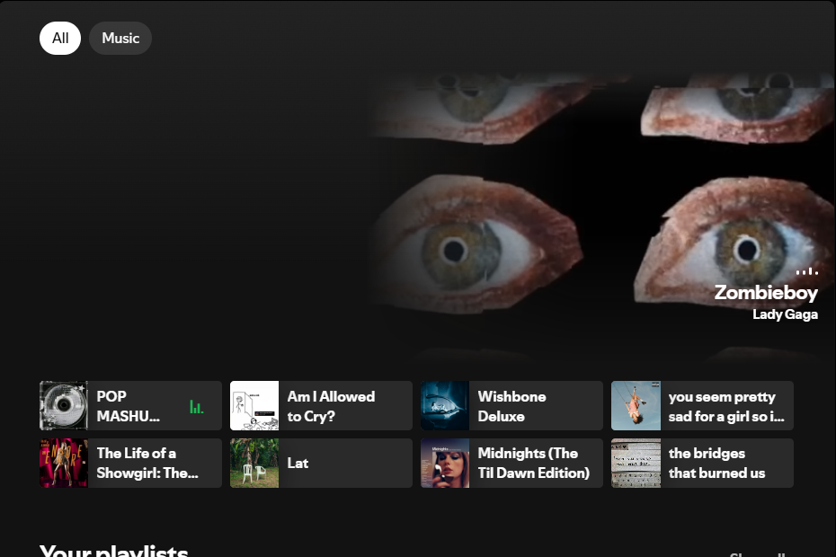
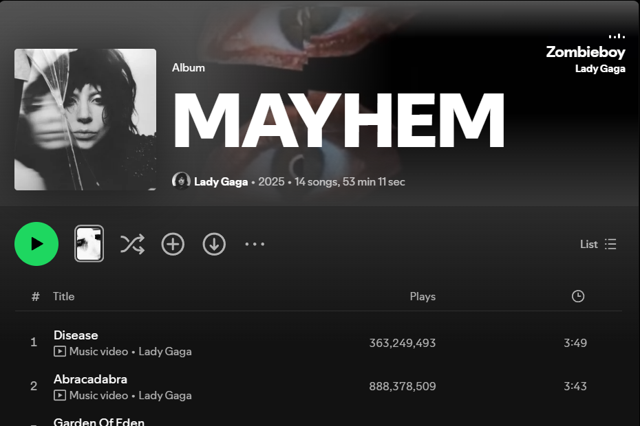
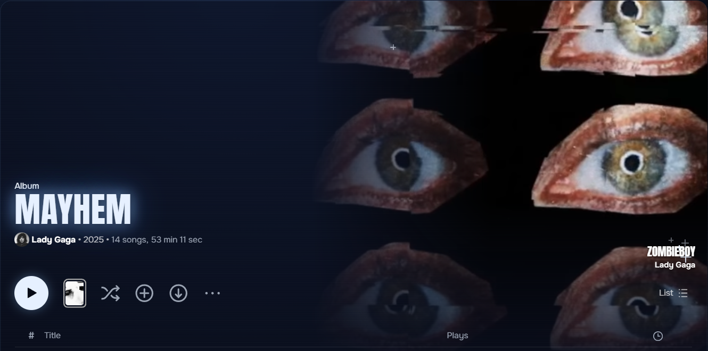

# Canvas Everywhere

A Spicetify extension that takes the Canvas of the song you're playing beyond the side panel: to your home page and to the top of its album or playlist.


| Home | Album |
|:---:|:---:|
|  |  |

With the Vitral theme:



## Where it shows

- **Home:** a band at the top of the page, only while a Canvas is playing
- **Album or playlist the song belongs to:** on the right of the page header

The song's name and artist appear over the video, in your theme's own title font. It works with any theme, and with [Vitral](https://github.com/SrPictus/vitral) it takes the place of the theme's large photo. Vitral doesn't need this extension either.

## Requirements

- [Spicetify](https://spicetify.app)
- The Now Playing panel open, or any view where Spotify is already playing the Canvas

## Install

### Marketplace (recommended)

Open the **Marketplace** in Spotify, go to the **Extensions** tab, search for **Canvas Everywhere** and click **Install**. It updates on its own.

### Manual, on Windows

In PowerShell:

```powershell
Invoke-WebRequest -UseBasicParsing "https://raw.githubusercontent.com/SrPictus/canvas-everywhere/main/canvas-everywhere.js" -OutFile "$env:APPDATA\spicetify\Extensions\canvas-everywhere.js"
```

```powershell
spicetify config extensions canvas-everywhere.js
```

```powershell
spicetify apply
```

### Manual, on macOS and Linux

```bash
curl -fsSL https://raw.githubusercontent.com/SrPictus/canvas-everywhere/main/canvas-everywhere.js -o ~/.config/spicetify/Extensions/canvas-everywhere.js
```

```bash
spicetify config extensions canvas-everywhere.js
```

```bash
spicetify apply
```

### Uninstall

From the Marketplace, click **Uninstall** on Canvas Everywhere. If you installed it by hand:

```bash
spicetify config extensions canvas-everywhere.js-
```

```bash
spicetify apply
```

## Known limits

- Only the song that's playing, because Spotify desktop can't play Canvas files directly. The extension shares the video Spotify is already showing, so it can't preview other songs on a page.
- Songs without a Canvas keep the normal photo.
- Sharpness depends on the song and on the resolution Spotify delivers at that moment, which can change while it plays.
- A Spotify update can break it.
- It turns itself off when the window is minimized, or when your system asks for reduced motion.

## License

[MIT](LICENSE)
