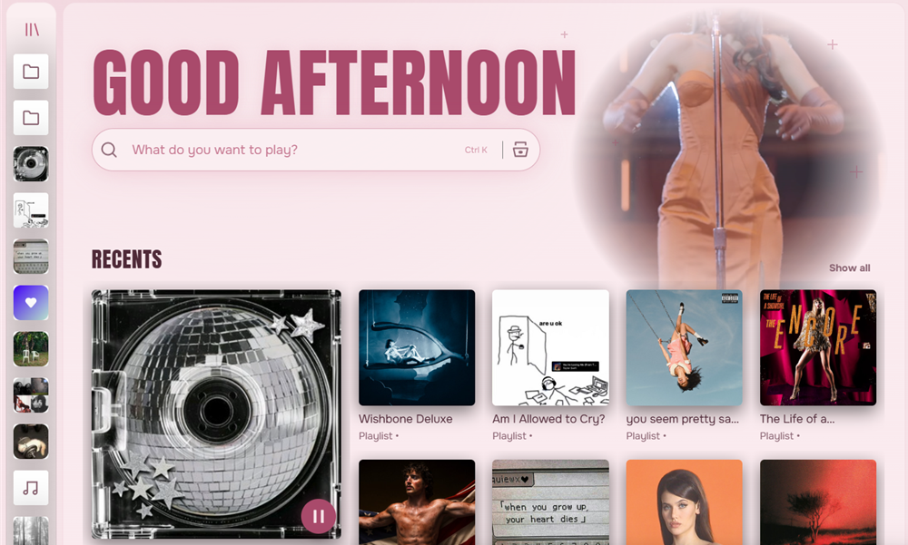

# Canvas Everywhere

A Spicetify extension that takes the Canvas of the song you're playing beyond the side panel: to your home page and to the top of its album or playlist.



## Where it shows

| Page | Vitral theme | Other themes |
|:---|:---|:---|
| Home | In the oval next to the greeting | Not shown |
| Album or playlist the song belongs to | In the oval over the large photo | Behind the page header |

It works with any theme, and fits in fully with [Vitral](https://github.com/SrPictus/vitral). Vitral doesn't need this extension either.

## Requirements

- [Spicetify](https://spicetify.app)
- The Now Playing panel open, or any view where Spotify is already playing the Canvas

## Install

From the Spicetify Marketplace: search for **Canvas Everywhere** in the Extensions tab and install it.

Or by hand:

1. Copy `canvas-everywhere.js` to the Spicetify `Extensions` folder (`%appdata%\spicetify\Extensions` on Windows, `~/.config/spicetify/Extensions` on macOS and Linux).
2. Run:

```bash
spicetify config extensions canvas-everywhere.js
```

```bash
spicetify apply
```

## Known limits

- Only the song that's playing, because Spotify desktop can't play Canvas files directly. The extension shares the video Spotify is already showing, so it can't preview other songs on a page.
- Songs without a Canvas keep the normal photo.
- Tested on Windows with Vitral and with no theme. A Spotify update can break it.
- It turns itself off when the window is minimized, or when your system asks for reduced motion.

## License

[MIT](LICENSE)
